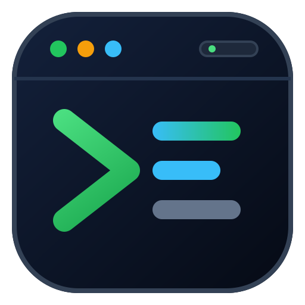

<div align="center">
  
  <h1>DevPanel</h1>
  <p><strong>Local Multi-Project &amp; Multi-Command Interactive PTY Terminal Orchestrator</strong></p>
  <p>A lightweight native desktop workspace for developers built with Tauri 2, React 19, xterm.js 6, and Rust <code>portable-pty</code>.</p>

  <p>
    <a href="https://github.com/WuDuKangBaZi/devpanel/releases"></a>
    <a href="./LICENSE"></a>
    
    
    
    
  </p>

  <p>
    <a href="./README.md">简体中文</a> · <strong>English</strong> · <a href="https://github.com/WuDuKangBaZi/devpanel/releases">Releases</a> · <a href="https://github.com/WuDuKangBaZi/devpanel/issues">Report Issue</a>
  </p>
</div>

---

## Overview

Modern full-stack development, microservice debugging, multi-package monorepos, and local AI/RPA agent workflows often require juggling a dozen terminal tabs — repeatedly changing directories, exporting environment variables, running start scripts, and hunting down ports.

**DevPanel** brings all your local dev commands into one fast, low-memory native desktop control panel:
- Powered by **Tauri 2 + native Rust PTY (`portable-pty`)** without Electron overhead.
- Full interactive terminal fidelity (24-bit ANSI truecolor, keyboard input, `Ctrl+C` signals, regex log search, clickable links).
- Group services and compose **Launch Bindings** to spin up an entire multi-repo stack concurrently or sequentially with configurable startup delays.

---

## Key Features

### 1. Multi-Project & Multi-Command Orchestration
- **Single & Multi-Command Projects**: Configure a single start command or multiple launch modes (`API`, `Worker`, `Web`, `Storybook`) per project, each backed by an isolated interactive PTY session tab.
- **Granular Runtime Overrides**: Per-project and per-command working directory (`cwd`), custom shell (`pwsh`, `powershell`, `cmd`, `zsh`, `bash`), environment variables (including bulk `.env` paste & parse), and `autoStart` on launch.
- **Clone & Drag-and-Drop Reorder**: Duplicate existing projects in one click and reorder projects, groups, and bindings via drag-and-drop.

### 2. Custom Groups & One-Click Launch Bindings
- **Custom Groups**: Organize projects by domain or layer (`Frontend`, `Core API`, `Infra`) and start/stop an entire group at once.
- **Launch Bindings**: Combine any set of projects or specific sub-commands into a reusable profile. Choose **parallel launch** or **sequential launch with custom millisecond delays and execution order** (ideal when backend APIs must listen before frontend apps start).

### 3. Smart Tech-Stack Auto-Detection
Pick any local folder and DevPanel automatically inspects manifests to pre-fill project name, group, recommended command, script alternatives, and local URL:
- **Frontend & Desktop**: Node.js (`pnpm` / `bun` / `yarn` / `npm`), Vite (parses `vite.config.*` port), Next.js, Nuxt, Angular, Tauri, Electron.
- **Backend & Languages**: Rust (single crate & Cargo Workspace binaries), Python (`uv` / `poetry` / `.venv` + FastAPI / Django / Flask / Streamlit), Go (including `air` hot-reload), Java (Spring Boot Maven / Gradle port detection), .NET (`.csproj` / `.sln`), Deno, PHP (Laravel `artisan` / Composer), Docker Compose.
- **2-Level Monorepo Discovery**: Automatically scans `package.json#workspaces`, `pnpm-workspace.yaml`, and nested `apps/*`, `packages/*`, `services/*`, `modules/*` packages into ready-to-run multi-command tabs.

### 4. Enhanced Interactive PTY Terminal
- **Lossless Ring Buffer**: Rust maintains a 256KB UTF-8/ANSI-aligned ring buffer with monotonic sequence numbers (`seq`) so switching tabs never drops output, while unsubscribed background sessions incur zero IPC serialization overhead.
- **Live Local URL Sniffer**: Automatically detects runtime `localhost` / `127.0.0.1` / `0.0.0.0` URLs printed to stdout (even when a dev server auto-increments its port) and surfaces a one-click **Open** button.
- **Search & Developer Ergonomics**: Floating `Ctrl+F` search bar (case-sensitive, regex, match counter), `Ctrl/Cmd + Click` web links, smart `Ctrl+C` copy-on-selection, context menu, `.log` file export, and one-click open in external editor (`code` / `cursor` / `windsurf`) or system terminal.

### 5. Native Desktop Polish & Full i18n
- **Zero-Orphan Process Tree Cleanup**: Sends `Ctrl+C` first for graceful shutdown, then escalates to Windows **Job Objects (`JOB_OBJECT_LIMIT_KILL_ON_JOB_CLOSE`) + `taskkill /F /T`** or Unix process-group `SIGTERM` → `SIGKILL` so child processes never leak or hold ports.
- **System Tray & Single-Instance Guard**: Optionally minimize to the system tray on close (with live running process count in the tray tooltip) and focus the existing window on second launch.
- **5 Built-in Themes & Full Bilingual UI**: Includes *Midnight*, *Obsidian*, *Nord*, *Daylight*, and *Warm Paper* themes (plus OS sync and dark-terminal-in-light-mode option), with full **English & Simplified Chinese (`zh-CN`)** localization across both React UI and native Rust tray/dialogs.

---

## Installation

Download prebuilt installers from [**GitHub Releases**](https://github.com/WuDuKangBaZi/devpanel/releases):
- **Windows**: `DevPanel_x.x.x_x64-setup.exe` (NSIS installer) and `.msi` installer.
- **macOS / Linux**: Build native bundles (`.dmg` / `.app` / `.deb` / `.AppImage`) from source via `npm run tauri build`.

---

## Configuration (`~/.dev-panel/projects.json`)

All projects, groups, and launch bindings are stored in `~/.dev-panel/projects.json` (`C:\Users\<User>\.dev-panel\projects.json` on Windows).
DevPanel watches this file via `notify` for **live hot-reload** on external edits, and provides **Export Backup / Merge Import / Replace Import** in **Settings → General**.

```json
{
  "groups": ["Frontend", "Backend"],
  "projects": [
    {
      "id": "web-app",
      "name": "Web Console",
      "cwd": "D:/Code/web-app",
      "command": "pnpm run dev",
      "shell": "pwsh.exe",
      "url": "http://localhost:5173",
      "group": "Frontend",
      "autoStart": false,
      "env": {
        "NODE_ENV": "development"
      }
    },
    {
      "id": "platform-monorepo",
      "name": "Platform Monorepo",
      "cwd": "D:/Code/platform",
      "command": "cargo run --bin gateway",
      "group": "Backend",
      "commands": [
        {
          "id": "gateway",
          "name": "API Gateway",
          "command": "cargo run --bin gateway",
          "cwd": "services/gateway",
          "url": "http://localhost:8080",
          "env": {
            "RUST_LOG": "info"
          }
        },
        {
          "id": "worker",
          "name": "Async Worker",
          "command": "uv run python worker.py",
          "cwd": "services/worker"
        }
      ]
    }
  ],
  "bindings": [
    {
      "id": "fullstack-dev",
      "name": "Fullstack Environment",
      "description": "Start API Gateway and Worker first, then launch Web Console",
      "sequential": true,
      "delayMs": 1200,
      "autoStart": false,
      "targets": [
        { "projectId": "platform-monorepo", "commandId": "gateway" },
        { "projectId": "platform-monorepo", "commandId": "worker" },
        { "projectId": "web-app" }
      ]
    }
  ]
}
```

---

## Keyboard Shortcuts

| Action | Windows / Linux | macOS |
| :--- | :--- | :--- |
| Toggle right terminal panel | `Ctrl + J` | `⌘ + J` |
| Search in active terminal | `Ctrl + F` | `⌘ + F` |
| Focus project search input | `Ctrl + K` | `⌘ + K` |
| Create new project | `Ctrl + N` | `⌘ + N` |
| Restart active project / command | `Ctrl + Shift + R` | `⌘ + ⇧ + R` |
| Open Settings | `Ctrl + ,` | `⌘ + ,` |
| Copy terminal selection (or send `SIGINT` if none) | `Ctrl + C` / `Ctrl + Shift + C` | `⌘ + C` |
| Open URL link in terminal output | `Ctrl + Click` | `⌘ + Click` |

---

## Development & Building from Source

### Prerequisites
- **Node.js** >= 20 (v22 / v24 recommended)
- **Rust** >= 1.85 (Edition 2024)
- [Tauri v2 Prerequisites](https://v2.tauri.app/start/prerequisites/) (C++ Build Tools & WebView2 on Windows)

### Commands

```bash
# Install dependencies
npm install

# Start Tauri development window with HMR
npm run tauri dev

# Run full verification suite (tsc + frontend tests + clippy -D warnings + cargo test)
npm run check

# Build production desktop bundles
npm run tauri build
```

---

## Author

- **Author**: Felix Yu
- **Email**: [wudukangbazi@gmail.com](mailto:wudukangbazi@gmail.com)
- **Repository**: [https://github.com/WuDuKangBaZi/devpanel](https://github.com/WuDuKangBaZi/devpanel)

---

## License

Released under the [MIT License](./LICENSE). Copyright © 2026 Felix Yu.
