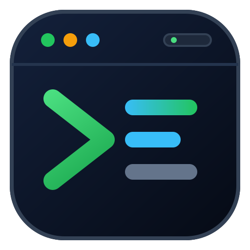

<div align="center">
  
  <h1>DevPanel</h1>
  <p><strong>本地多项目与多命令交互式终端编排面板</strong></p>
  <p>基于 Tauri 2 + React 19 + xterm.js 6 + Rust <code>portable-pty</code> 构建的轻量原生桌面开发工具</p>

  <p>
    <a href="https://github.com/WuDuKangBaZi/devpanel/releases"></a>
    <a href="./LICENSE"></a>
    
    
    
    
  </p>

  <p>
    <strong>简体中文</strong> · <a href="./README.en.md">English</a> · <a href="https://github.com/WuDuKangBaZi/devpanel/releases">下载安装包 (Releases)</a> · <a href="https://github.com/WuDuKangBaZi/devpanel/issues">问题反馈 (Issues)</a>
  </p>
</div>

---

## 简介

在日常全栈联调、微服务开发、Monorepo 多包协作或本地 AI / RPA Agent 调试中，开发者往往需要同时打开十几个终端窗口，反复切换目录、设置环境变量、敲入启动命令并排查端口和日志。

**DevPanel** 将分散的本地开发命令收敛到一个轻量、极速的原生桌面面板中：
- 告别 Electron 级别的内存占用，基于 **Tauri 2 + Rust 原生伪终端（PTY）** 驱动。
- 保留完整交互式终端体验（ANSI 真彩色、键盘输入、`Ctrl+C` 信号、日志正则搜索、链接直达）。
- 支持将多个微服务或前后端子命令组合成**绑定启动方案（Bindings）**，一键并发或按顺序延迟拉起整套联调环境。

---

## 核心特性

### 1. 多项目与多命令编排
- **单命令 & 多命令模式**：单个项目既可配置一条主命令，也可配置多个子命令模式（如 `API`、`Worker`、`Studio`、`Storybook`），每个子命令拥有独立 PTY 会话标签页。
- **细粒度运行参数**：支持项目级与子命令级独立工作目录（`cwd`）、自定义 Shell（`pwsh` / `powershell` / `cmd` / `zsh` / `bash`）、环境变量（支持直接粘贴 `.env` 文本批量解析）以及随面板打开自动启动（`autoStart`）。
- **克隆与拖拽排序**：支持一键克隆现有项目配置，侧边栏支持鼠标拖拽调整项目、分组与绑定方案顺序。

### 2. 自定义分组与一键绑定启动（Launch Bindings）
- **自定义分组管理**：按业务域或架构层（如 `Frontend`、`Core API`、`Infra`）组织项目，支持整组一键启动/停止。
- **跨项目绑定编排**：自由勾选多个项目或具体子命令组成联调方案，支持**并发启动**或**按顺序延迟启动（可配置毫秒间隔与启动先后顺序）**，满足「先起数据库/后端，再起前端」的依赖场景。

### 3. 智能目录技术栈识别
选择或输入本地目录后，自动分析配置文件并填充名称、分组、推荐命令、候选脚本与默认端口地址：
- **前端 / 桌面端**：Node.js（自动识别 `pnpm` / `bun` / `yarn` / `npm`）、Vite（解析 `vite.config.*` 端口）、Next.js、Nuxt、Angular、Tauri、Electron。
- **后端与多语言**：Rust（单包 & Cargo Workspace 多二进制识别）、Python（`uv` / `poetry` / `.venv` + FastAPI / Django / Flask / Streamlit）、Go（支持 `air` 热重载识别）、Java（Spring Boot Maven / Gradle 端口解析）、.NET（`.csproj` / `.sln`）、Deno、PHP（Laravel `artisan` / Composer）、Docker Compose。
- **多层 Monorepo 扫描**：自动解析 `package.json#workspaces`、`pnpm-workspace.yaml` 及 `apps/*`、`packages/*`、`services/*`、`modules/*` 二级目录，自动生成多命令模式。

### 4. 交互式终端增强
- **零丢包日志回放**：Rust 后端维护 256KB UTF-8 / ANSI 边界安全环形缓冲与单调递增序列号（`seq`），切换项目或收起面板再展开绝不丢失输出，后台未订阅会话零冗余 IPC 推送。
- **实时端口 URL 嗅探**：自动从终端输出流中嗅探实际监听的 `localhost` / `127.0.0.1` / `0.0.0.0` 地址（如 Vite 端口自动递增后），一键在浏览器中打开。
- **搜索与便捷操作**：内置 `Ctrl+F` 搜索栏（区分大小写 / 正则表达式 / 匹配计数 / 上下跳转）、`Ctrl/Cmd + 点击` 打开终端内链接、选中文本 `Ctrl+C` 复制、右键菜单、一键导出 `.log` 日志文件、一键在外部编辑器（VS Code / Cursor / Windsurf）或系统终端中打开当前目录。

### 5. 原生桌面体验与国际化
- **进程树级优雅清理**：停止服务或退出应用时先发送 `Ctrl+C` 等待优雅退出；超时未退出时在 Windows 下通过 **Job Object (`JOB_OBJECT_LIMIT_KILL_ON_JOB_CLOSE`) + `taskkill /F /T`**、在 macOS/Linux 下通过进程组 `SIGTERM` → `SIGKILL` 彻底清理子进程树，杜绝孤儿进程占端口。
- **托盘驻留与单实例保护**：支持关闭窗口最小化到系统托盘（托盘悬停实时显示运行中进程数），重复启动自动唤醒已有窗口。
- **5 套明暗主题 + 完整中英文国际化**：内置午夜深蓝、黑曜碳黑、北欧极光、晴空浅白、暖纸护眼 5 套主题（支持跟随系统及「浅色界面下保持深色终端」），前后端（含托盘菜单、原生对话框、自动识别提示）完整支持 **简体中文 / English** 实时切换。

---

## 下载与安装

前往 [**GitHub Releases**](https://github.com/WuDuKangBaZi/devpanel/releases) 页面下载对应系统安装包：
- **Windows**：提供 `DevPanel_x.x.x_x64-setup.exe`（NSIS 安装包）与 `.msi` 安装包。
- **macOS / Linux**：可从源码执行 `npm run tauri build` 构建对应平台原生包（`.dmg` / `.app` / `.deb` / `.AppImage`）。

---

## 配置文件说明

所有项目、分组与绑定方案均保存在用户主目录 `~/.dev-panel/projects.json`（Windows 下为 `C:\Users\<用户名>\.dev-panel\projects.json`）。
DevPanel 内置文件热监听（`notify`），使用外部编辑器直接修改保存后界面将**自动热更新**；同时支持在「设置 → 通用与配置」中一键**导出备份 / 合并导入 / 覆盖导入**。

```json
{
  "groups": ["Frontend", "Backend"],
  "projects": [
    {
      "id": "web-app",
      "name": "Web Console",
      "cwd": "D:/Code/web-app",
      "command": "pnpm run dev",
      "shell": "pwsh.exe",
      "url": "http://localhost:5173",
      "group": "Frontend",
      "autoStart": false,
      "env": {
        "NODE_ENV": "development"
      }
    },
    {
      "id": "platform-monorepo",
      "name": "Platform Monorepo",
      "cwd": "D:/Code/platform",
      "command": "cargo run --bin gateway",
      "group": "Backend",
      "commands": [
        {
          "id": "gateway",
          "name": "API Gateway",
          "command": "cargo run --bin gateway",
          "cwd": "services/gateway",
          "url": "http://localhost:8080",
          "env": {
            "RUST_LOG": "info"
          }
        },
        {
          "id": "worker",
          "name": "Async Worker",
          "command": "uv run python worker.py",
          "cwd": "services/worker"
        }
      ]
    }
  ],
  "bindings": [
    {
      "id": "fullstack-dev",
      "name": "全栈联调环境",
      "description": "按顺序先启动网关与 Worker，再启动前端控制台",
      "sequential": true,
      "delayMs": 1200,
      "autoStart": false,
      "targets": [
        { "projectId": "platform-monorepo", "commandId": "gateway" },
        { "projectId": "platform-monorepo", "commandId": "worker" },
        { "projectId": "web-app" }
      ]
    }
  ]
}
```

---

## 快捷键一览

| 功能 | Windows / Linux | macOS |
| :--- | :--- | :--- |
| 展开 / 收起右侧终端日志面板 | `Ctrl + J` | `⌘ + J` |
| 在当前终端内搜索日志 | `Ctrl + F` | `⌘ + F` |
| 聚焦侧边栏搜索框 | `Ctrl + K` | `⌘ + K` |
| 新建项目 | `Ctrl + N` | `⌘ + N` |
| 重启当前选中的项目 / 子命令 | `Ctrl + Shift + R` | `⌘ + ⇧ + R` |
| 打开设置面板 | `Ctrl + ,` | `⌘ + ,` |
| 复制终端选中文本（无选中时发送中断信号） | `Ctrl + C` / `Ctrl + Shift + C` | `⌘ + C` |
| 打开终端输出中的 URL 链接 | `Ctrl + 左键点击` | `⌘ + 左键点击` |

---

## 本地开发与构建

### 环境要求
- **Node.js** >= 20（推荐 v22 / v24）
- **Rust** >= 1.85（Edition 2024）
- [Tauri v2 系统前置依赖](https://v2.tauri.app/start/prerequisites/)（Windows 需安装 Microsoft C++ 生成工具与 WebView2）

### 常用命令

```bash
# 1. 安装前端依赖
npm install

# 2. 启动开发模式（前端热更新 + Tauri 桌面窗口）
npm run tauri dev

# 3. 运行全量质量检查（TypeScript 类型检查 + 前端单测 + Clippy 零警告 + Rust 单测）
npm run check

# 4. 构建生产环境安装包
npm run tauri build
```

### 目录结构

```text
DevPanel/
├── public/                 # 静态图标与零闪烁主题/语言初始化脚本
├── src/                    # React 19 + TypeScript 前端源码
│   ├── components/         # 标题栏、侧边栏、终端视图、项目/绑定/分组/设置弹窗
│   ├── config/             # 应用与作者元信息配置 (appMeta.ts)
│   ├── hooks/              # PTY/配置状态编排、设置持久化、主题管理 Hooks
│   ├── i18n/               # 类型安全中英文国际化词典与上下文 (zh-CN / en)
│   ├── themes/             # 5 套内置界面与 xterm 终端配色方案
│   ├── types/              # 前后端 IPC 契约数据结构
│   └── utils/              # 跨平台工具函数与会话/绑定解析逻辑
└── src-tauri/              # Tauri 2 + Rust 后端源码
    └── src/
        ├── commands.rs     # Tauri IPC 命令入口
        ├── config.rs       # 配置文件原子读写、校验、排序、导入导出与热监听
        ├── detector.rs     # 多语言与多层 Monorepo 技术栈自动识别器
        ├── i18n.rs         # 后端运行期多语言状态与托盘动态翻译
        ├── lib.rs          # 单实例、系统托盘、窗口关闭与优雅退出生命周期
        └── pty_manager.rs  # 跨平台 PTY 会话池、环形缓冲、端口嗅探与进程树清理
```

---

## 作者与联系

- **作者**：Felix Yu
- **邮箱**：[wudukangbazi@gmail.com](mailto:wudukangbazi@gmail.com)
- **GitHub**：[https://github.com/WuDuKangBaZi/devpanel](https://github.com/WuDuKangBaZi/devpanel)

---

## 开源协议

本项目基于 [MIT License](./LICENSE) 开源，Copyright © 2026 Felix Yu。
